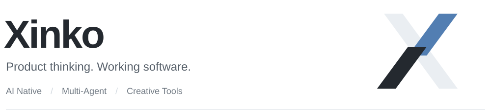

  

  你好，欢迎来到我的 GitHub 👋

  
  
  
  

## 关于我

- **方向**：AI Native 产品设计 · 多 Agent 协作系统 · 全栈开发
- **作品**：数学错因诊断小程序（Math Insight） · 本地优先思维导图（栖思） · Web 动效参考库（Motion Vault）
- **关注**：多模型路由与编排 · MCP 工具调用 · 结构化检索（RAG） · 前端交互与工程落地

## 技术栈

**语言与框架**  

**AI / Agent**  

**数据与基础设施**  

## 精选项目

| 项目 | 简介 |
| :-- | :-- |
| **[Math Insight · 错因智诊](https://github.com/Xinko2438/Math-Insight)** | 数学学习小程序（开发中） · 结构化 OCR、公式点选校对、提交快照与后台异步诊断 |
| **[栖思 Qisi](https://github.com/Xinko2438/qisi-mindmap)** | 本地优先的思维导图工作台 · 图文节点、多维关系线与单文件便携导出 |
| **[Motion Vault](https://github.com/Xinko2438/Motion-Vault)** | Web 动效与交互参考库 · 双模预览沙箱、源码映射与 Agent 按需检索 CLI |

**开源贡献** · [OpenMausBot #4544](https://github.com/milind-soni/OpenMausBot/pull/4544)：修复自定义数据目录下的桌面文件保存与路径校验，补充回归测试（Draft PR）。
